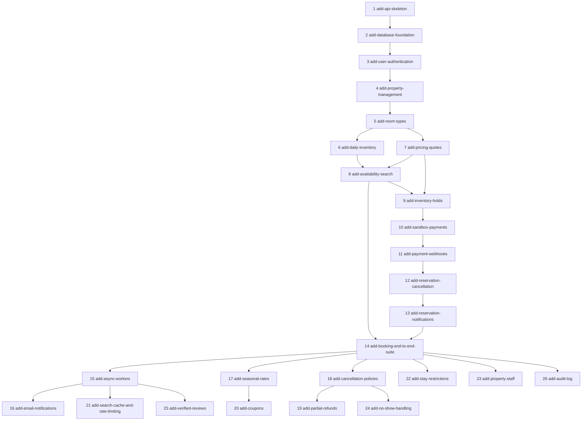

# Change map

Ruta ordenada de changes de OpenSpec. Se genera a partir de [roadmap.md](roadmap.md) y de [reference/plan-inicial.md](reference/plan-inicial.md), con el formato de [roadmap.md](roadmap.md#formato-del-change-map).

- Un change activo por vez, en el orden de la tabla.
- El **Change ID** es el nombre de la carpeta en `openspec/changes/`.
- Un change con ADRs requeridos en estado **Propuesto** no empieza hasta que esos ADRs se aceptan.
- La versión 1 está detallada. La versión 2 figura en la tabla con detalle breve y se refina al terminar la versión 1. Las versiones 3 y 4 se listan como objetivos, sin changes.

## Posiciones sobre los puntos abiertos del roadmap

1. **Holds sin expiración en la versión 1 → liberación oportunista más barrido periódico.** Crear un hold y calcular disponibilidad (búsqueda y calendario del host) vencen primero, en la misma transacción, los holds expirados de esas fechas y tipos de habitación. Además, un servicio de Compose (`hold-sweeper`) corre el comando `expire-holds` cada minuto hasta que Celery Beat lo reemplace en el change 15. Todas las vías usan el mismo servicio, que pasa la reserva de `PENDING_PAYMENT` a `EXPIRED` con un update condicional sobre el estado. Solo libera inventario si ese update afectó la fila, así la liberación ocurre una sola vez aunque corra en paralelo (invariante 4). Costo a resolver en el `design.md` del change 9: la búsqueda pasa a escribir y a tomar locks sobre `inventory_days`. Una opción es saltear las filas bloqueadas (`SKIP LOCKED`) y dejarlas al barrido, que es un error conservador porque nunca vende de más.
2. **Notificaciones → outbox mínima en la versión 1.** Confirmar y cancelar una reserva escriben un registro de notificación (outbox) en la misma transacción que la transición. En la versión 1, un despachador síncrono lo entrega a log o consola, y se puede consultar. En la versión 2, un worker de Celery lee la misma outbox y manda emails. La definición de terminado de la versión 1 (punto 9) se mantiene sin email real.
3. **ADRs pendientes.** Cada fila indica qué ADR tiene que estar aceptado antes de empezar. El orden en que se necesitan es: 0009 (antes del change 2), 0006 (change 5), 0005 (change 7), 0008 (change 10) y 0007 (change 11).
4. **Dinero al cancelar en la versión 1.** Un plan reembolsable devuelve el total si se cancela antes de la fecha límite del snapshot, y nada después. Un plan no reembolsable no devuelve nada. El reembolso total entra en `add-reservation-cancellation` (change 12), como `Refund` con estado propio según ADR-0007: cancelar la reserva y reembolsar son dos ciclos distintos. Los reembolsos parciales y las penalidades configurables quedan para la versión 2 (changes 18 y 19).
5. **Historial de transiciones.** Vive en `reservations` de forma permanente, como dato del dominio (actor, motivo y fecha de cada transición), desde el change 9. El módulo `audit` de la versión 2 cubre las acciones críticas transversales y no lo reemplaza.
6. **Una reserva, un tipo de habitación.** En la versión 1, una reserva es de un solo tipo de habitación, con cantidad mayor o igual a 1 (pregunta abierta 5 de `domain.md`). Se fija en el change 7, porque la cotización ya trabaja con esa forma.

## Tabla

| # | Change ID | Objetivo | Capacidades (nuevas / modificadas) | Depende de | ADRs requeridos | Versión | Estado |
|---|---|---|---|---|---|---|---|
| 1 | `add-api-skeleton` | La API levanta en Docker y responde `/health` con errores en formato uniforme | nuevas: `api-foundation` | — | 0010 | 1 | pendiente |
| 2 | `add-database-foundation` | La API se conecta a PostgreSQL con migraciones de Alembic y expone `/ready`, que verifica la base | modificadas: `api-foundation` | 1 | 0009 | 1 | pendiente |
| 3 | `add-user-authentication` | Un usuario se registra, inicia sesión y renueva tokens; los endpoints exigen rol | nuevas: `identity` | 2 | — | 1 | pendiente |
| 4 | `add-property-management` | Un host crea, edita y envía a revisión sus propiedades; un admin las publica | nuevas: `properties` | 3 | — | 1 | pendiente |
| 5 | `add-room-types` | Un host define tipos de habitación con capacidad para sus propiedades | nuevas: `rooms` | 4 | 0006 | 1 | pendiente |
| 6 | `add-daily-inventory` | Un host carga capacidad y bloqueos por fecha y ve su calendario de disponibilidad | nuevas: `inventory` | 5 | 0006 | 1 | pendiente |
| 7 | `add-pricing-quotes` | Un host configura la tarifa base y si el plan es reembolsable; un viajero cotiza una o más habitaciones de un tipo, con desglose | nuevas: `pricing` | 5 | 0005 | 1 | pendiente |
| 8 | `add-availability-search` | Un viajero busca por destino, fechas y ocupación y recibe alojamientos disponibles con precio | nuevas: `search` | 6, 7 | 0005, 0006 | 1 | pendiente |
| 9 | `add-inventory-holds` | Un viajero retiene inventario para su selección sin que el sistema venda de más | nuevas: `reservations`; modificadas: `inventory`, `search` | 7, 8 | 0005, 0006 | 1 | pendiente |
| 10 | `add-sandbox-payments` | Un viajero inicia el pago de su reserva pendiente en el sandbox de Stripe | nuevas: `payments` | 9 | 0005, 0008 | 1 | pendiente |
| 11 | `add-payment-webhooks` | Un webhook verificado confirma la reserva una sola vez, aunque llegue duplicado o fuera de orden | modificadas: `payments`, `reservations` | 10 | 0007, 0008 | 1 | pendiente |
| 12 | `add-reservation-cancellation` | El viajero consulta y cancela su reserva según la política, con reembolso total si corresponde; el host ve el cambio en su inventario | modificadas: `reservations`, `inventory`, `payments` | 11 | 0007, 0008 | 1 | pendiente |
| 13 | `add-reservation-notifications` | Viajero y propietario quedan notificados al confirmarse o cancelarse una reserva | nuevas: `notifications`; modificadas: `reservations` | 12 | — | 1 | pendiente |
| 14 | `add-booking-end-to-end-suite` | Un test recorre la definición de terminado de la versión 1 de punta a punta | modificadas: ninguna (solo tests) | 13 | — | 1 | pendiente |
| 15 | `add-async-workers` | Redis, worker y beat corren en Compose; Beat reemplaza a `hold-sweeper` y completa estadías pasadas | nuevas: `background-jobs`; modificadas: `reservations` | 14 | 0009 | 2 | pendiente |
| 16 | `add-email-notifications` | La outbox se entrega por email desde un worker | modificadas: `notifications` | 15 | — | 2 | pendiente |
| 17 | `add-seasonal-rates` | El precio por noche varía por fecha y temporada | modificadas: `pricing` | 14 | 0005 | 2 | pendiente |
| 18 | `add-cancellation-policies` | El host configura políticas de cancelación con penalidades por plan tarifario | modificadas: `pricing`, `reservations` | 14 | — | 2 | pendiente |
| 19 | `add-partial-refunds` | Una cancelación con penalidad genera un reembolso parcial ante el proveedor | modificadas: `payments`, `reservations` | 18 | 0007 | 2 | pendiente |
| 20 | `add-coupons` | Un viajero aplica un cupón o promoción y el descuento queda en el snapshot | modificadas: `pricing` | 17 | 0005 | 2 | pendiente |
| 21 | `add-search-cache-and-rate-limiting` | Búsquedas y datos públicos se cachean en Redis, y los endpoints sensibles tienen rate limiting | modificadas: `search`, `api-foundation` | 15 | — | 2 | pendiente |
| 22 | `add-stay-restrictions` | El host define estadía mínima y máxima y cierres a la llegada o a la salida | modificadas: `inventory` | 14 | — | 2 | pendiente |
| 23 | `add-property-staff` | El host invita empleados con permisos limitados sobre ciertas propiedades | modificadas: `properties`, `identity` | 14 | — | 2 | pendiente |
| 24 | `add-no-show-handling` | El host marca un no-show y se aplica la regla de liberación y penalidad | modificadas: `reservations`, `inventory` | 18 | — | 2 | pendiente |
| 25 | `add-verified-reviews` | Solo quien completó una estadía la reseña, una vez | nuevas: `reviews` | 15 | — | 2 | pendiente |
| 26 | `add-audit-log` | Las acciones críticas transversales quedan registradas en un log de auditoría consultable por admin | nuevas: `audit` | 14 | — | 2 | pendiente |

## Dependencias

Los changes 6 y 7 no dependen entre sí; se ejecutan en el orden de la tabla porque hay un solo change activo por vez. El change 9 depende del 8 porque la liberación oportunista modifica la búsqueda.

## Versión 1: detalle

### 1. `add-api-skeleton`
- **Alcance:** app FastAPI con configuración por variables de entorno, router versionado (`/api/v1`), errores uniformes, `/health` (liveness), Dockerfile multi-stage con usuario no root, Compose con `api`, pytest y lint dentro del contenedor, CI que corre lint y tests. Define los comandos del proyecto en `CLAUDE.md`.
- **Afuera:** base de datos, `/ready` (sin dependencias no tiene nada que verificar; llega en el change 2) y cualquier endpoint de negocio.
- **Escenarios con test:** `/health` responde 200; una ruta inexistente y un error de validación devuelven el formato uniforme; un error inesperado no expone detalles internos.

### 2. `add-database-foundation`
- **Alcance:** servicio `db` en Compose y base separada para tests de integración, `AsyncSession` con `asyncpg` y `lazy="raise"`, Alembic con una migración inicial vacía, y `/ready` (readiness), que verifica la conexión a la base.
- **Afuera:** tablas de negocio.
- **Escenarios con test:** `/ready` responde 503 con la base caída y 200 con la base disponible; las migraciones suben y bajan limpias; cada test corre aislado en su propia transacción.

### 3. `add-user-authentication`
- **Alcance:** registro, login con OAuth2 Password Bearer, access token de vida corta, refresh token rotado y revocable, Argon2id, roles `traveler`, `host` y `admin`, y dependencia de autorización por rol.
- **Afuera:** recuperación de contraseña, verificación de email, perfil editable.
- **Escenarios con test:** email duplicado rechazado; contraseña incorrecta sin revelar si el usuario existe; un refresh token reutilizado revoca la familia; un endpoint de host rechaza a un traveler.

### 4. `add-property-management`
- **Alcance:** alta y edición de propiedades por su host, estados `DRAFT` → `PENDING_REVIEW` → `PUBLISHED` y `SUSPENDED` por admin, zona horaria y moneda de la propiedad, y la primera autorización por recurso (dueño de la propiedad).
- **Afuera:** imágenes, staff, servicios detallados.
- **Escenarios con test:** un host no puede editar la propiedad de otro host; solo un admin publica; una propiedad no publicada no es visible públicamente; las transiciones inválidas se rechazan.

### 5. `add-room-types`
- **Alcance:** tipos de habitación bajo una propiedad, con capacidad de adultos y niños, camas y servicios básicos.
- **Afuera:** unidades físicas (`Unit`).
- **Escenarios con test:** solo el dueño de la propiedad crea o edita sus tipos; la capacidad tiene que ser válida; un tipo de una propiedad ajena da 404 o 403 de forma consistente.

### 6. `add-daily-inventory`
- **Alcance:** tabla `inventory_days` según ADR-0006, carga de capacidad por rango de fechas, bloqueos manuales, calendario del host y la fórmula única de disponibilidad.
- **Afuera:** restricciones de estadía (versión 2) y holds.
- **Escenarios con test:** la restricción de base impide `booked + held + blocked > capacity`; bajar la capacidad por debajo de lo reservado se rechaza; un bloqueo reduce la disponibilidad; el calendario muestra las noches `[check_in, check_out)`.

### 7. `add-pricing-quotes`
- **Alcance:** plan tarifario con precio base por noche e impuestos simples por tipo de habitación, marcado como reembolsable (con fecha límite) o no reembolsable, y un endpoint de cotización con desglose por noche, en unidades menores (ADR-0005). Una cotización, y después la reserva, es de un solo tipo de habitación con cantidad mayor o igual a 1.
- **Afuera:** tarifas por temporada, cupones, multi-moneda, penalidades configurables y reservas con varios tipos de habitación.
- **Escenarios con test:** el desglose suma exacto con redondeo por línea; la cotización multiplica bien por la cantidad de habitaciones; la cotización no retiene inventario; un rango de fechas inválido o una cantidad menor a 1 se rechazan; la fecha límite de cancelación se calcula en la zona de la propiedad.

### 8. `add-availability-search`
- **Alcance:** búsqueda por destino, fechas y ocupación con filtros básicos (precio y tipo de alojamiento), paginada, que devuelve solo propiedades publicadas con disponibilidad para todas las noches y el precio total.
- **Afuera:** cache, ordenamiento por relevancia, búsqueda geográfica.
- **Escenarios con test:** una propiedad sin cupo en alguna noche no aparece; la ocupación por encima de la capacidad del tipo la excluye; los bloqueos se respetan; las propiedades no publicadas no aparecen.

### 9. `add-inventory-holds`
- **Alcance:** crear hold y reserva `PENDING_PAYMENT` con snapshot inmutable en una sola transacción con locks sobre `inventory_days`, `Idempotency-Key`, liberación oportunista de holds vencidos al crear holds y al calcular disponibilidad (con lo que modifica la búsqueda y el calendario), el comando `expire-holds` con el servicio `hold-sweeper` en Compose, el abandono del viajero (`CANCELLED`) y el historial permanente de transiciones con actor y motivo. Resuelve en su `design.md` la duración del hold (pregunta abierta 4 de `domain.md`) y cómo acotar los locks en la búsqueda.
- **Afuera:** pagos y expiración con Celery.
- **Escenarios con test:** dos solicitudes concurrentes por el último cupo dan una reserva y un rechazo; el hold retiene todas las noches o ninguna; la misma `Idempotency-Key` devuelve el mismo hold y con otro payload da 409; liberar un hold vencido dos veces en paralelo (barrido y búsqueda) libera una sola vez; un hold vencido no descuenta disponibilidad en la búsqueda; cambiar la tarifa no altera el snapshot.

### 10. `add-sandbox-payments`
- **Alcance:** puerto `PaymentProvider`, adaptador de Stripe en modo test, inicio de pago de una reserva `PENDING_PAYMENT` propia con idempotencia y la entidad `Payment` con su estado.
- **Afuera:** webhooks y confirmación (change 11), reembolsos.
- **Escenarios con test:** un viajero no puede pagar la reserva de otro; repetir el inicio con la misma clave no crea un segundo `Payment`; no se puede pagar una reserva vencida; un error del proveedor deja un estado consistente. El proveedor se reemplaza por un fake en los tests.

### 11. `add-payment-webhooks`
- **Alcance:** endpoint de webhook con verificación de firma, `WebhookEvent` con ID único, transición `PENDING_PAYMENT` → `CONFIRMED` (retenidas pasan a reservadas), consulta al proveedor si el evento es ambiguo, y la carrera entre pago y vencimiento (pregunta abierta 1).
- **Afuera:** reembolsos automáticos más allá de lo que decida esa carrera.
- **Escenarios con test:** una firma inválida se rechaza sin efecto; el mismo evento dos veces confirma una sola vez; los eventos fuera de orden no retroceden el estado; el pago aprobado sobre un hold vencido sigue la regla decidida; el cliente no puede confirmar por su cuenta.

### 12. `add-reservation-cancellation`
- **Alcance:** consulta de reservas propias (viajero) y de sus propiedades (host), cancelación de `CONFIRMED` por viajero, host o admin con liberación de las noches futuras, y reembolso total ante el proveedor cuando el plan es reembolsable y se cancela antes de la fecha límite. El reembolso es un `Refund` con estado propio (ADR-0007) que se actualiza con evidencia del proveedor, y la reserva expone el estado financiero derivado. El `design.md` define qué pasa con el dinero cuando cancela el host o un admin.
- **Afuera:** reembolsos parciales y penalidades configurables (changes 18 y 19).
- **Escenarios con test:** cancelar antes de la fecha límite reembolsa el total; cancelar después, o con un plan no reembolsable, no reembolsa nada; cancelar dos veces no genera dos reembolsos; un fallo del proveedor deja la reserva cancelada con el reembolso en `FAILED` y reintentable; un viajero no cancela reservas ajenas; el inventario liberado aparece en el calendario del host.

### 13. `add-reservation-notifications`
- **Alcance:** outbox de notificaciones escrita en la misma transacción que confirmar o cancelar, un despachador síncrono a log o consola que marca la entrega, y la consulta de notificaciones propias.
- **Afuera:** email real y reintentos con worker (change 16).
- **Escenarios con test:** confirmar genera una notificación para viajero y propietario; si la transición falla no queda notificación; un webhook duplicado no duplica notificaciones; un usuario no ve notificaciones ajenas.

### 14. `add-booking-end-to-end-suite`
- **Alcance:** un test de API que recorre los 11 pasos de la definición de terminado de `vision.md` contra PostgreSQL real, con el proveedor fake, y la revisión de que el OpenAPI generado documente todos los endpoints de la versión 1.
- **Afuera:** pruebas de carga (versión 3).
- **Escenarios con test:** el recorrido feliz completo; el recorrido con webhook duplicado; el recorrido con dos viajeros por el último cupo; el recorrido con cancelación y la liberación reflejada en el calendario.

## Versión 2: detalle breve

- **15 `add-async-workers`:** Redis, `worker` y `beat` en Compose (ADR-0010). Beat reemplaza al servicio `hold-sweeper`, invoca el mismo servicio de expiración y hace el paso a `COMPLETED`. Tests: la expiración por Beat sigue liberando una sola vez.
- **16 `add-email-notifications`:** el worker entrega la outbox por SMTP (Mailpit en desarrollo) con reintentos. Tests: un fallo del SMTP no pierde la notificación.
- **17 `add-seasonal-rates`:** precios por fecha y temporada que reemplazan la tarifa base de la versión 1. Tests: una estadía que cruza temporadas cotiza por noche.
- **18 `add-cancellation-policies`:** políticas configurables por plan, con penalidades por tramo. Tests: la política vigente al reservar es la que se aplica.
- **19 `add-partial-refunds`:** reembolsos parciales según la penalidad, sobre el modelo de `Refund` del change 12 (ADR-0007). Tests: la suma de reembolsos nunca supera lo pagado.
- **20 `add-coupons`:** cupones y promociones en la cotización y el snapshot. Tests: un cupón agotado se rechaza bajo concurrencia.
- **21 `add-search-cache-and-rate-limiting`:** cache selectiva y rate limiting en Redis. Tests: con Redis caído, la búsqueda funciona y el inventario sigue consistente (escenario obligatorio de ADR-0002).
- **22 `add-stay-restrictions`:** estadía mínima y máxima y cierres a la llegada o a la salida. Tests: una búsqueda que viola una restricción excluye ese tipo.
- **23 `add-property-staff`:** invitación de empleados con permisos limitados. Tests: un empleado no actúa fuera de sus propiedades.
- **24 `add-no-show-handling`:** resuelve las preguntas abiertas 2 y 3 de `domain.md`. Tests: la liberación de noches restantes es única.
- **25 `add-verified-reviews`:** reseñas de estadías `COMPLETED`, una por estadía. Tests: no se reseña sin estadía completada ni dos veces.
- **26 `add-audit-log`:** módulo `audit` para acciones críticas transversales (moderación, cambios de permisos, operaciones de admin sobre pagos). No reemplaza el historial de transiciones de `reservations`, que es dato del dominio. Tests: una suspensión de propiedad por admin queda auditada con actor y motivo.

## Versiones 3 y 4

Objetivos en [roadmap.md](roadmap.md#versión-3-production--business). Sus changes se definen al terminar la versión 2.
